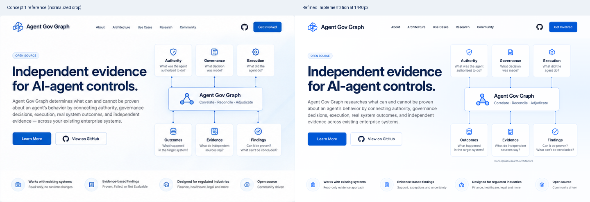

# Concept 1: final refinement review

## Direct comparison

Left: the supplied Concept 1 panel, cropped from the four-concept board and normalized to 1440 × 912. Right: the actual 1440px browser screenshot, at the same scale. The reference is a raster image about 750 × 475px; enlarging it cannot recover original font or vector geometry. The board's labels and surrounding gutters are excluded.

## Refinements made after screenshot review

- Self-hosted Inter replaces the system-font fallback as the primary face. Adjusted headline size, weight, tracking and leading against the reference; the first font pass was too narrow and was corrected through measured text widths and another capture.
- Redrew the layered geometric logo, centered the gear icon and refined all four feature-strip icons. Preserved the navy, white, pale-blue and electric-blue palette.
- Restored the upper and lower diagram row proportions, raised the central panel, refined its label alignment and border, and adjusted the feature strip's vertical position. Softened an initially over-visible diagonal background treatment.
- Replaced independent SVG connector coordinates with card-owned CSS connectors. Desktop line lengths share the layout's row-gap values; mobile branches and vertical spine segments belong to the cards. No JavaScript measures or redraws the diagram.
- Below 600px, all six cards become readable horizontal cards on a vertical spine, with the AGG core between the two groups. This is a distinct mobile arrangement, not a scaled desktop image. Card descriptions are 13px, headings 16px and the central description 12px. Header navigation wraps, and navigation/action targets are at least 44px high.
- Added Research Collaborations using the supplied research framing and explicit potential for complementary work with partner verification teams. The header's Get Involved button leads to it.

## Desktop landmarks

Reference positions are approximate readings from the enlarged raster, not original design-file measurements. Implementation positions come from the browser.

| Landmark | Concept 1 at normalized desktop scale | Refined implementation |
| --- | --- | --- |
| Hero text left edge | about 62px | 62px |
| Main navigation start | about 469px | about 470px |
| First headline line ink width | about 656px | about 654px |
| Top architecture cards | about y140px | y141px |
| Central architecture panel | about y352px, 114px high | y353px, 114px high |
| Bottom architecture cards | about y528px | y529px |
| Feature strip starts | about y758px | y758px |
| Feature strip ends | about y912px | y912px |

## Screenshots

- [Desktop, 1440px](desktop.png)
- [Tablet, 768px](tablet.png) and [first viewport](tablet-viewport.png)
- [Mobile, 390px](mobile.png), [first viewport](mobile-viewport.png) and [architecture detail](mobile-architecture.png)
- [Mobile, 320px](mobile-320.png), [first viewport](mobile-320-viewport.png) and [architecture detail](mobile-320-architecture.png)

## Research boundaries and intentional differences

The hero says “researches” rather than presenting the conceptual chain as an established enterprise capability. The feature strip describes a read-only evidence approach and findings with uncertainty rather than guaranteeing integration without runtime changes or using unconditional “Proven” labels. A small visible diagram caption identifies the conceptual research architecture.

Below the mockup area, anchored content distinguishes bounded demonstrated research, synthetic positive-rule tests, experimental limits and undemonstrated live positive control-effectiveness attestation. It does not promise production-ready attestation, enterprise-wide assurance or universally reliable correlation. The historical background page and existing project/reference links remain accessible.

Inter closely matches the reference's character but is not a verified identification of its original typeface. Minor glyph, antialiasing, SVG stroke/curve and gradient differences remain because only a raster reference was supplied. The reproduction is component-based, not pixel-identical. Added lower-page research content and the deliberate mobile arrangement are outside the desktop reference's scope.

## Checks performed

- Served the website locally over HTTP.
- Static validation passed for both pages: local assets and fragments, unique IDs, headings, claim boundary, self-hosted font asset and license.
- Browser checks passed at **320, 375, 390, 430, 768, 1024 and 1440px**: no horizontal overflow, all six cards present, card text at least 12px and inside its card, desktop connector endpoints meeting the core, mobile branches reaching their cards and spine within the core's width, header/action touch targets at least 44px, and working anchor controls.
- Background-page round trip, reduced motion, contact-action destination, favicon and zero failed local requests passed. Machine-readable measurements are in [browser-results.json](browser-results.json).
- Confirmed the project repository has GitHub Issues enabled. The contact link opens a pre-titled issue composer; no issue or inquiry was submitted during validation.
- `git diff --check` passed. No compilation step exists: the HTML, CSS, SVG and licensed font are the deployable static output. Playwright is optional developer tooling, not a shipped dependency.

## Contact decision

The verified contact route is currently **public GitHub Issues**, explicitly labeled on the page as requiring an account and appropriate only for non-confidential initial inquiries. The public owner profile did not list an email or website when checked on 2026-10-09. No email was inferred and no backend form was added.

Optional owner decision: supply a preferred public email or contact URL if research partners should have a direct or private inquiry route. This does not block the functioning GitHub contact action.

## Release boundary

Update to existing PR #1 only. No merge, deployment or publishing-configuration change. GitHub Pages remains configured to publish the `main` branch after owner-approved changes.
